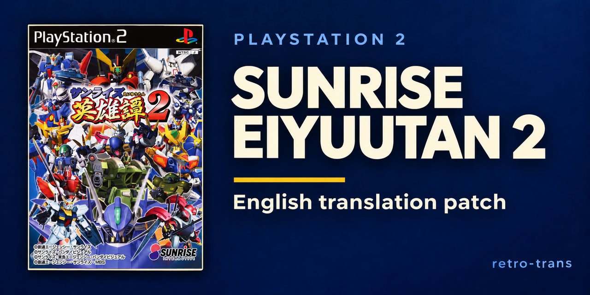

# Sunrise Eiyuutan 2 — translation project



An English translation of **Sunrise Eiyuutan 2** for PlayStation 2, Japanese original edition **SLPS-25070**, with the tools and English working exports used by the project.

## Contribute

Translation and playtesting are still in progress. Bug reports, proofreading and playtesting are welcome through [GitHub Issues](https://github.com/retro-trans/Sunrise-Eiyuutan-2/issues) or Discord:

**[discord.gg/MssepShjmB](https://discord.gg/MssepShjmB)**

## Play it

The first public release is **[v0.8.0](https://github.com/retro-trans/Sunrise-Eiyuutan-2/releases/tag/v0.8.0)**. It packages the verified cumulative local v0.2.31 build. The game bytes are identical; v0.8.0 is the public release number, not a measured completion percentage.

It includes the inventoried main-story dialogue, encyclopedia entries, 6,463 shared-bank battle captions, translated menus/help, movie and episode-preview subtitles, and romaji/English opening and ending lyrics. The latest fixes improve Trade text, formation lists, equipment summaries and font proportions.

**Some Japanese remains and full-game playtesting is unfinished.** Read [Status and known limits](docs/STATUS.md) and the [release notes](docs/release_0.8.0.md) before playing.

### Apply

**Automatic:** Use [Retro Trans](https://github.com/retro-trans/retro-trans-tools). Click **Refresh catalog**, open **Automatic**, select your original Japanese ISO, choose **Latest** (v0.8.0), then click **Patch** and save to a new output file. The app recognizes the source by its full hash and verifies the downloaded patch and completed image.

Download `Sunrise-Eiyuutan-2-English-v0.8.0.xdelta` from the release. Apply it with [DeltaPatcher](https://github.com/marco-calautti/DeltaPatcher) or [xdelta3](https://github.com/jmacd/xdelta) to your own unpacked Japanese disc image.

| Your source image | Patch |
|---|---|
| Sunrise Eiyuutan 2, Japanese original, SLPS-25070 | `Sunrise-Eiyuutan-2-English-v0.8.0.xdelta` |

```text
xdelta3 -d -s "Sunrise Eiyuutan 2 (Japan).iso" Sunrise-Eiyuutan-2-English-v0.8.0.xdelta "Sunrise Eiyuutan 2 EN v0.8.0.iso"
```

Source SHA-256: `5d6f96c972ac65bb5dddbadc832dc749a59b86b8c4507408231bed725b8524e8`

Output SHA-256: `8fa9f17a838b4c22c591467ad343b7130d159efcd00b5cbb413c43175b8e2f7f`

The source must be **2,622,685,184 bytes**; the patched output is **2,627,004,416 bytes**. If your patcher reports a checksum mismatch, check the source against `README-v0.8.0.txt`. Keep source verification enabled. This first release has no upgrade patch for older English test images. Extract a CHD to ISO before manual patching.

**Boot the patched image fresh and load an in-game memory-card save.** Old emulator save states can retain the previous executable, text and graphics. Physical PS2/OPL compatibility has not been verified.

## Translate it

Start with **[TRANSLATING.md](TRANSLATING.md)** for the edit/review workflow and **[TOOLS.md](TOOLS.md)** for the tool inventory.

You need your own copy of the game. Japanese disc files and source-script dumps remain local. Public English exports retain source hashes, IDs and runtime controls so changes can be reviewed without distributing the original script.

The repository is a working-source snapshot. Historical build inputs and external movie caches are not included, and some tools still refer to the original local workspace. It is not yet a portable, one-command rebuild kit. Use the release `.xdelta` to play.

## What is here

| Path | Contents |
|---|---|
| `TRANSLATING.md` | Translation, review and contribution workflow |
| `TOOLS.md` | Extraction, patching, layout, verification and debug tools |
| `tools/` | Python tools, native UI probes and focused tests |
| `work/translation/en/*.en.json` | English-only working exports and manifests |
| `work/translation/en/dat/*.en.json` | English structured-table exports, including draft material outside release coverage |
| `work/glossary/glossary.json` | Names, terminology and source references; Japanese lookup terms are retained |
| `docs/STATUS.md` | Playable coverage, known limits and testing status |
| `docs/releases/v0.8.0/` | Release build manifest and validation record |
| `CHANGELOG.md` | Public release entry and historical local-build record |
| `assets/social-preview.jpg` | Repository banner |

## Using these tools

Python 3.11 and the pinned packages in `requirements.txt` are used for the local pipeline. Most tools show a plan unless passed `--write`. Run the plan and inspect it first. Some debug launchers use `--run`; read their help before execution.

```text
python tools/iso.py
python tools/iso.py --extract
python tools/afs.py
python tools/afs.py --extract
python tools/text.py
python tools/text.py --write
```

Place your original `Sunrise Eiyuutan 2 (Japan).iso` in the project root. These tools target SLPS-25070 only. Movie work additionally uses FFmpeg, .NET/IPUenc and local source-media caches. Source fonts and external binaries are not included.

## Do not sell this

This patch is free. Do not sell it or anything made with it: pre-patched discs/images, loaded memory cards/consoles, or paywalled/ad-gated downloads.

This is an unofficial fan translation. The original game, artwork, characters, music and trademarks belong to their respective owners.

## Credits

| Role | |
|---|---|
| Project direction and testing | [binhlt0402](https://github.com/binhlt0402) |
| Translation, editing, tooling and reverse engineering | Codex / OpenAI models, directed by binhlt0402 |

This is a machine-produced and edited translation. Model-assisted accuracy, editorial and proofreading passes do not imply human fluency review or a full playthrough. No complete human-proofread line count is claimed.

Thanks to [Noto Sans JP](https://github.com/notofonts/noto-cjk), [IPUenc](https://github.com/ravenDS/IPUenc), PCSX2, Whisper, FFmpeg and xdelta. Noto Sans JP licensing is recorded in [THIRD_PARTY_NOTICES.md](THIRD_PARTY_NOTICES.md). The documentation format follows [retro-trans/SRW-Z](https://github.com/retro-trans/SRW-Z); SRW-Z's game-specific credits and completion claims do not apply here.

## Status

The release remains in development. [Status and known limits](docs/STATUS.md) records the untranslated holds, movie qualifications and incomplete gameplay validation. [CHANGELOG.md](CHANGELOG.md) preserves the local build history, including failed or incomplete checks.
